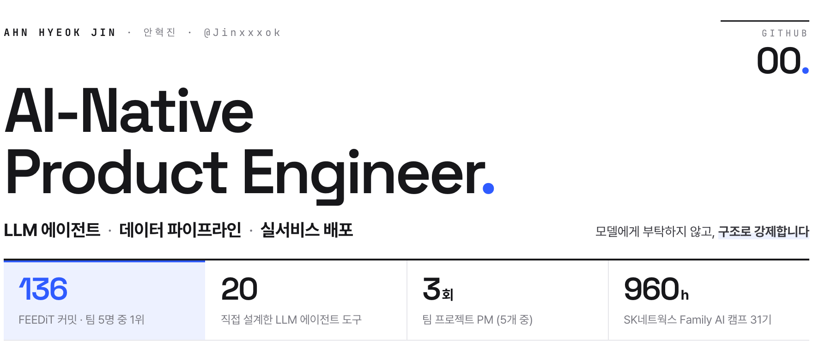
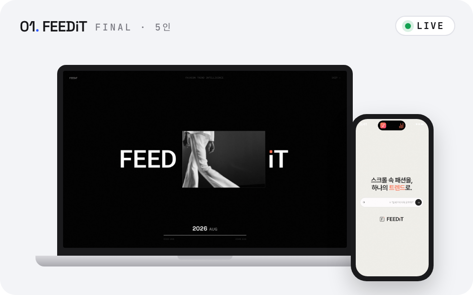
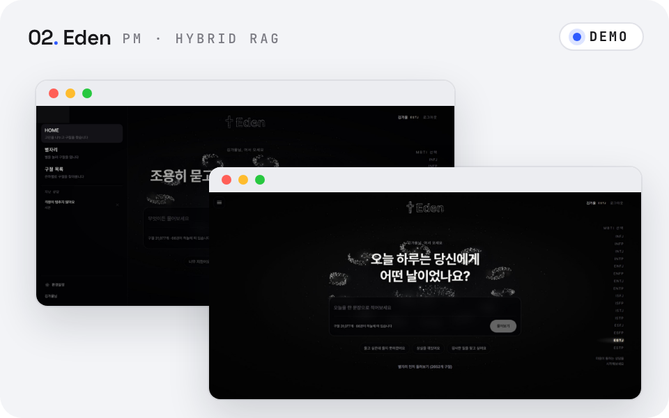
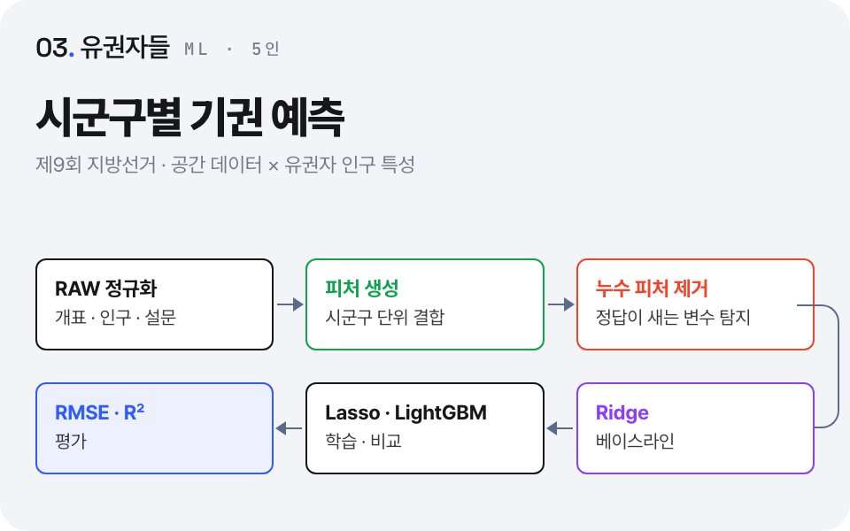
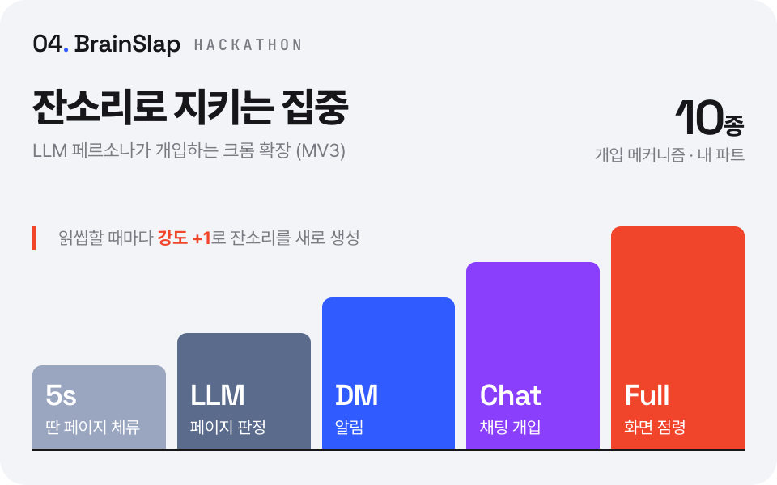

<picture>
  <source media="(prefers-color-scheme: dark)" srcset="assets/header-dark.png">
  
</picture>

안녕하세요, **안혁진**입니다. LLM 에이전트와 데이터 파이프라인을 만들고 실서비스까지 배포합니다. 
"지어내지 마"라고 모델에게 부탁하는 대신 **도구 목록 · 자리표시자 · 기계 대조**로 코드가 규칙을 지키게 만들고, 
고치기 전에 재고, 목표에 못 미친 수치까지 기록합니다.

 

 

## Selected Work

<table>
<tr>
<td width="50%" valign="top">

### [FEEDiT](https://github.com/feedit-official/feedit)
AI 패션 트렌드 분석 & 구매 판단 플랫폼 
2026.08 – 10 · AI 캠프 최종 프로젝트 · 5인 · AI 챗봇 에이전트 + Frontend

- 20개 도구로 움직이는 **LLM 에이전트** 설계
- 숫자 환각을 막는 **사실 검증 계층** (L3)
- 커밋 **136건 · 팀 1위** · 해커톤 **인기 2위**

`Django` `OpenAI` `Celery` `PostgreSQL` `Docker`

**[Live ↗](https://fee-di-t-frontend.vercel.app)** · [Repo](https://github.com/feedit-official/feedit) · [발표 사이트](https://feedit-official.github.io/feedit-presentation/)

</td>
<td width="50%" valign="top">

### [Eden](https://jinxxxok.github.io/eden/)
하이브리드 RAG(Vector + Graph) 상담 챗봇 
2026.07 – 08 · 3 · 4차 프로젝트 · PM + Frontend

- 벡터 검색 + **Neo4j 그래프** 하이브리드 RAG
- **RAGAS**로 재고, 낮은 점수까지 원인 분석
- Streamlit → **React SPA + DRF + SSE** 재구축

`React` `TypeScript` `LangChain` `Neo4j` `pgvector`

**[Demo ↗](https://jinxxxok.github.io/eden/)** · [Repo](https://github.com/SKNETWORKS-FAMILY-AICAMP/SKN31-4th-3Team) · [3차 Repo](https://github.com/SKNETWORKS-FAMILY-AICAMP/SKN31-3rd-3Team)

</td>
</tr>
<tr>
<td width="50%" valign="top">

### [유권자들](https://github.com/SKNETWORKS-FAMILY-AICAMP/SKN31-2nd-1Team)
시군구별 투표 이탈(기권) 예측 
2026.05 – 06 · 2차 프로젝트 · 5인 · ML/DL 모델링 · 전처리

- 개표 · 인구 · 설문 데이터 정규화 · 피처 생성
- 정답이 새는 **누수(Leakage) 피처** 탐지 · 제거
- Ridge → Lasso · LightGBM, **RMSE · R²** 평가

`Python` `scikit-learn` `LightGBM` `Pandas`

**[Repo ↗](https://github.com/SKNETWORKS-FAMILY-AICAMP/SKN31-2nd-1Team)**

</td>
<td width="50%" valign="top">

### [BrainSlap](https://github.com/Parkdongkwan/Brainslap)
LLM 페르소나가 잔소리로 집중을 지키는 크롬 확장 
2026.07 · 제8회 K-디지털 트레이닝 해커톤 출품 · 사용자 행동 제어 파트

- 딴 페이지 5초 체류 → **LLM이 판정** → 개입
- **개입 메커니즘 10종** — DM → 채팅 → 화면 점령
- 읽씹하면 **강도 +1**로 잔소리를 다시 생성

`Chrome MV3` `JavaScript` `Flask` `LangChain`

**[Repo ↗](https://github.com/Parkdongkwan/Brainslap)**

</td>
</tr>
</table>

## Tech Stack

<table>
<tr><td width="130"><b>AI · LLM</b></td><td>      </td></tr>
<tr><td width="130"><b>Backend · Data</b></td><td>         </td></tr>
<tr><td width="130"><b>Frontend</b></td><td>      </td></tr>
<tr><td width="130"><b>Infra · Tools</b></td><td>      </td></tr>
</table>

## Highlights

- **원티드 AI 챔피언십 2026 해커톤** — FEEDiT 출품, 커머스/쇼핑 부문 인기 2위
- **제8회 K-디지털 트레이닝 해커톤 (2026)** — BrainSlap 출품
- **SK네트웍스 Family AI 캠프 31기** 수료 — 960시간 · 팀 프로젝트 5개 · PM 3회
- **프로그래머스 PCCE Lv.3** · 정보처리기사 필기 합격
- [니차내차](https://github.com/SKNETWORKS-FAMILY-AICAMP/SKN31-1st-4Team) — 중고차 시세 조회 서비스, 첫 팀 프로젝트 PM (팀 커밋 72건 중 50건)
- [AI-STUDY](https://github.com/Jinxxxok/AI-STUDY) — 파이썬 → 데이터 분석 → ML/DL → LLM 학습 기록, 커밋 100건+

 

안혁진 · <a href="mailto:hyeokjiny01@gmail.com">hyeokjiny01@gmail.com</a>

